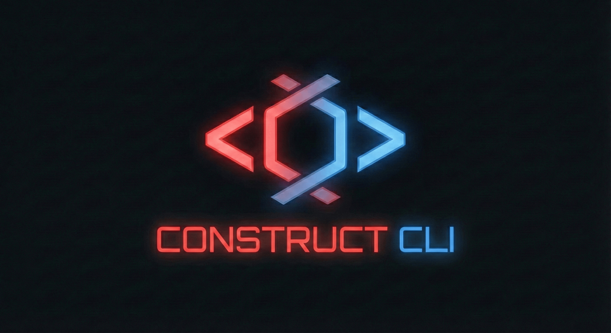
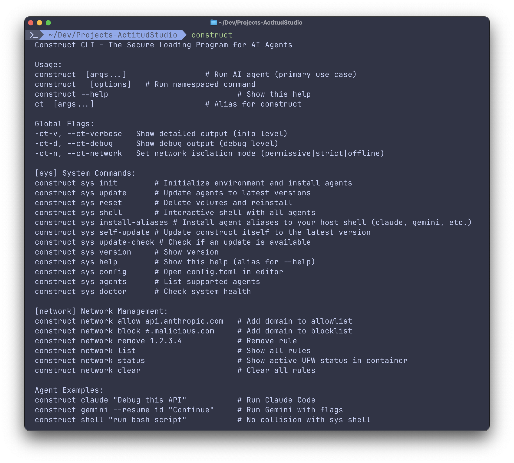
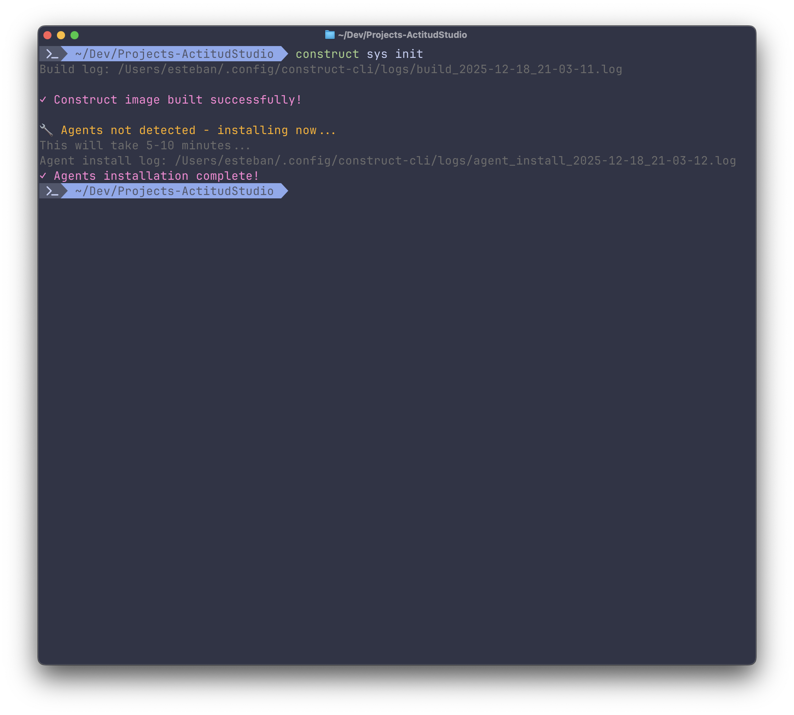
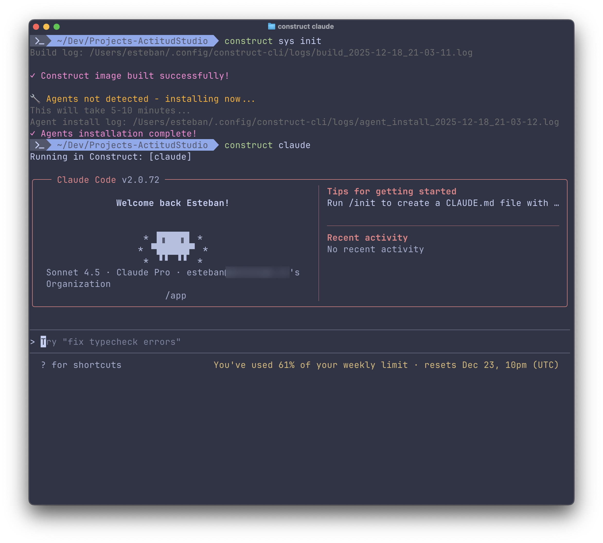
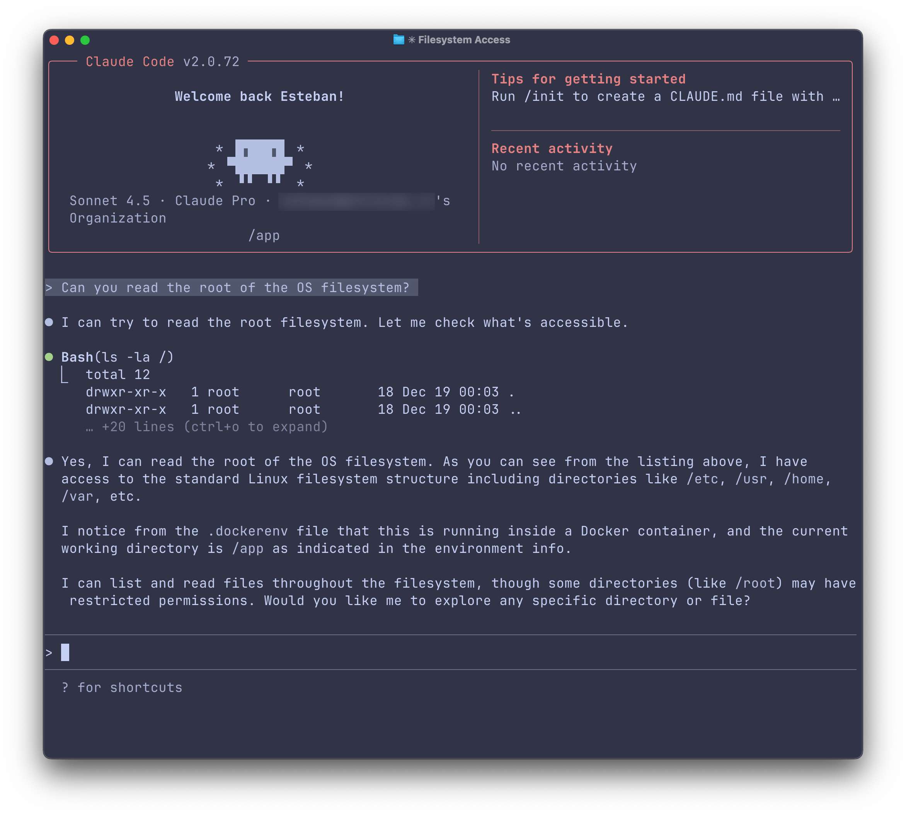

# The Construct CLI

<p align="center">
  
</p>

**The Construct** is a single-binary CLI that boots a clean and isolated sandbox, preloaded with AI agents. MicroVMs by default (embedded, nothing to install), your OCI runtime as fallback. It keeps your host free of dependency sprawl, adds optional network isolation, and keeps your machine safe from prompt-injected or derping agents.

## Highlights

- **One command** to run any AGENT inside a secured, isolated sandbox, spawned from your cwd without path escape
- **Zero Config**: works out of the box on macOS, Linux, and Windows (WSL)
- **MicroVM by default**: hardware-level isolation via microsandbox; falls back to the best available OCI runtime on hosts without microVM support
- **Daemon mode**: reuse one sandbox across projects; `$HOME` directories are auto-learned, elsewhere add roots via `[daemon] mount_paths` or `construct sys daemon roots add`
- **Sentinel Credential Proxy**: host-side authenticated egress proxy keeping real API keys on the host while minting shape-mimicking sentinels, inspecting HTTPS CONNECT requests with dynamic leaf CA certificates, enforcing domain fronting guards, dropping outbound leaks, and supporting opt-in raw TCP database tunnels (`[network] allowed_tcp`)
- **Network Policy Tiers**: `allowlist` (with built-in ecosystem presets for npm, PyPI, crates, Go, GitHub, apt), `open`, `internet`, or `none`, with diagnostic inspection (`construct sys network explain`) and real-time audit logging (`construct sys network log`)
- **Modular Toolchains**: auto-detects project languages from markers and lazily fetches lightweight multi-arch OCI toolchains (Go, Rust, Python, Node, PHP, Ruby, Zig, Dart, Kotlin, Java, Swift) cached at `~/.cache/construct/toolchains`
- **Host Git & Workspace Protection**: locks host `.git` repositories using OS immutable attributes (`chattr +i` / `chflags uchg`), masks `.git` in guest mounts, and supports disposable execution via `--clone` with automatic git bundle patch export
- **SSH agent forwarding and a full clipboard bridge**: text and image pasting for Claude, Copilot, Antigravity, Qwen, and Pi
- **Host loopback browsing**: headless browser agents reach host dev sites on `localhost`/`*.localhost`
- **User-defined packages**: apt, mise, bun, npm, pip, cargo, or gems
- **Parallel workflows**: git worktree management for parallel AI agent workflows

## Quick Install

```bash
# One-line installer (macOS & Linux)
curl -fsSL https://raw.githubusercontent.com/EstebanForge/construct-cli/main/scripts/install.sh | bash

# Or manage with mise
mise use -g github:EstebanForge/construct-cli

# Or with Homebrew
brew install EstebanForge/tap/construct-cli
```

**[Detailed Installation Guide →](docs/INSTALLATION.md)**

## Quick Start

```bash
# First-time setup (prepares the sandbox image, installs agents)
construct sys image init

# Run an agent
construct claude "Help me refactor this function"

# PATH shims: bare `claude` runs sandboxed from any caller
construct sys shims install
```

More examples and the full command list: [Quick Reference](docs/QUICK-REFERENCE.md). Running agents from orchestrators and IDEs: [Harnesses](docs/HARNESSES.md).

## Screenshots






## Agents

14 agents: Claude Code, Codex, Pi, Pig, Antigravity, Copilot, OpenCode, Amp, Qwen, Cline, Droid, Goose, Crush, Kilo Code — plus Claude Code with custom provider endpoints (Zai GLM, MiniMax M2, Kimi K2, Qwen, Mimo).

**[Full agent list →](docs/AGENTS.md)**

## Documentation

### Getting Started

| Topic | Description |
|-------|-------------|
| [**Installation**](docs/INSTALLATION.md) | Platform-specific installation, troubleshooting |
| [**Quick Reference**](docs/QUICK-REFERENCE.md) | Everyday commands, examples, PATH shims |
| [**Configuration**](docs/CONFIGURATION.md) | Complete config reference for all settings |
| [**Security**](docs/SECURITY.md) | Container security, secret redaction, best practices |

### Features

| Topic | Description |
|-------|-------------|
| [**Sentinel Proxy & Network**](docs/TODO-SENTINEL-PROXY.md) | Host-side egress proxy, sentinel key substitution, network policy tiers |
| [**Hide Secrets Mode**](docs/HIDE-SECRETS.md) | Prevent agents from seeing raw secrets in files or env |
| [**VM Backend**](docs/ARCHITECTURE-DESIGN.md#41-microvm-isolation-engine-microsandbox-backend) | Default microVM isolation via microsandbox |
| [**Modular Toolchains**](docs/ARCHITECTURE-DESIGN.md) | On-demand multi-arch OCI toolchain fetching and caching |
| [**Providers**](docs/PROVIDERS.md) | Configure custom Claude API endpoints |
| [**Packages**](docs/PACKAGES.md) | User-defined package management |
| [**Architecture**](docs/ARCHITECTURE-DESIGN.md) | Technical design and internals |

### Reference

| Topic | Description |
|-------|-------------|
| [**Agents**](docs/AGENTS.md) | Complete list of supported agents |
| [**Clipboard**](docs/CLIPBOARD.md) | Clipboard bridge architecture |
| [**Development**](docs/DEVELOPMENT.md) | Contributing and development guide |
| [**Contributing**](docs/CONTRIBUTING.md) | Contribution guidelines |

Full index: [docs/INDEX.md](docs/INDEX.md)

## Security

- ✅ MicroVM isolation by default (`backend = "msb"`, microsandbox) with OCI fallback
- ✅ Host-side egress CONNECT proxy with session-token authentication and MITM sentinel swapping (real keys never enter the sandbox)
- ✅ Network policy tiers (`allowlist`, `open`, `internet`, `none`) with ecosystem presets and raw non-HTTP TCP tunneling
- ✅ Domain fronting guards and strict DNS rebinding / private IP refusal
- ✅ Host git repository protection with immutable flags and read-only `.git` guest masking
- ✅ Disposable execution mode via `--clone` with automatic git bundle patch generation
- ✅ Ephemeral sandboxes with zero path escape outside allowed mounts
- ✅ Workspace secret redaction and output stream masking
- ✅ Reproducible CI builds with SHA256 checksums

**[Complete Security Guide →](docs/SECURITY.md)**

## Contributing

Contributions are welcome! Please see:
- [**Development Guide**](docs/DEVELOPMENT.md)
- [**Contributing Guidelines**](docs/CONTRIBUTING.md)

## License

MIT License - see [LICENSE](LICENSE) for details

## Acknowledgments

Built with ❤️ for my kids. Go wild and experiment. Have fun.

---

**Documentation:** [docs/](docs/) | **Issues:** [GitHub Issues](https://github.com/EstebanForge/construct-cli/issues) | **Releases:** [GitHub Releases](https://github.com/EstebanForge/construct-cli/releases)
